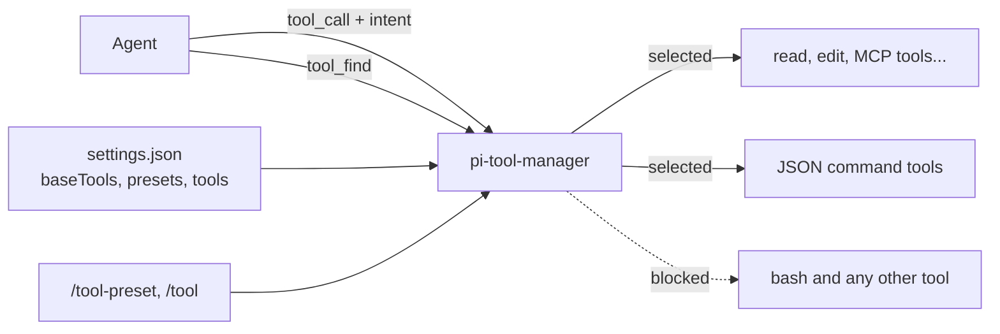

<p align="center">
  
</p>

<p align="center"><strong>Restrict, organize and explain the tools your pi agent can use</strong></p>

<p align="center">
  <a href="https://github.com/Tyarran/pi-tool-manager/actions/workflows/ci.yml">
    
  </a>
  <a href="https://pi.dev">
    
  </a>
  
  
</p>

---

A coding agent with a shell can do anything, and every MCP server adds more tools to its reach.
pi-tool-manager is a [pi](https://pi.dev) extension that puts you back in control:
you choose which tools the agent may use with presets that you switch per session,
you replace the shell with command-line tools declared in JSON whose arguments are validated,
and the agent reaches every tool through a single `tool_call` that requires the intent behind the call,
so the session history tells you why each tool was used.



## Installation

Requirements: [mise](https://mise.jdx.dev), or opam 2 and Node.js ≥ 22.19 installed manually.

```sh
git clone https://github.com/Tyarran/pi-tool-manager.git ~/Projects/pi-tool-manager
cd ~/Projects/pi-tool-manager
mise install
opam init -a --bare            # first opam use only
opam switch create . 5.5.0 --deps-only --with-test -y
eval $(opam env)
npm ci
dune build
```

Register the extension in `~/.pi/agent/settings.json`:

```json
{
  "extensions": ["~/Projects/pi-tool-manager"]
}
```

## Quickstart

Add a minimal configuration next to it, in `~/.pi/agent/settings.json` or in the `.pi/settings.json` of a project:

```json
{
  "pi-tool-manager": {
    "baseTools": ["read", "edit", "write", "bash"],
    "defaultPreset": "no-bash",
    "presets": {
      "no-bash": ["-bash"],
      "read-only": ["read"]
    }
  }
}
```

Run `/reload` in pi. The agent now sees only `tool_call` and `tool_find`, and reaches `read`, `edit` and `write` through them; `bash` is blocked.
Change the selection for the current session at any time:

```text
/tool-preset read-only     # only read
/tool +bash                # allow bash until the next preset switch
```

An invalid configuration disables the extension and reports the error: pi keeps its default tools until the configuration is fixed and reloaded.

## Documentation

| To... | Read |
|---|---|
| Understand what the extension does | [How it works](docs/how-it-works.md) |
| Choose the tools of a session | [Selection and presets](docs/configuration.md) |
| Replace the shell with safe tools | [Command-line tools](docs/command-tools.md) |
| Understand or change the code | [CONTRIBUTING.md](CONTRIBUTING.md) |

## Contributing

See [CONTRIBUTING.md](CONTRIBUTING.md).

## License

MIT — see [LICENSE](LICENSE).
