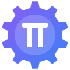
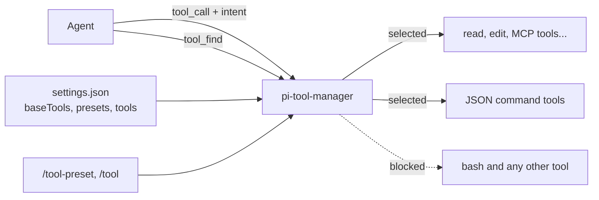

---
hide:
  - navigation
---

# pi-tool-manager

<figure markdown="span">
{ width="120" }
</figure>

Restrict, organize and explain the tools your pi agent can use.

A coding agent with a shell can do anything, and every MCP server adds more tools to its reach.
pi-tool-manager is a [pi](https://pi.dev) extension that puts you back in control:
you choose which tools the agent may use with presets that you switch per session,
you replace the shell with command-line tools declared in JSON whose arguments are validated,
and the agent reaches every tool through a single `tool_call` that requires the intent behind the call,
so the session history tells you why each tool was used.

## Get started

1. [Install the extension](installation.md).
2. Follow the [Quickstart](quickstart.md): a first preset, and the commands to change the tools of a session.

## Guides

- [How it works](how-it-works.md): the selection, `tool_call` and `tool_find`, the strict whitelist and the commands.
- [Selection and presets](configuration.md): `baseTools`, presets and how global and project settings merge.
- [Command-line tools](command-tools.md): declare tools in JSON, with validated parameters and an optional shell mode.

## Project

- [Contributing](https://github.com/Tyarran/pi-tool-manager/blob/main/CONTRIBUTING.md): architecture, code guidelines and workflow.
- [Issues](https://github.com/Tyarran/pi-tool-manager/issues): bugs and feature requests.
